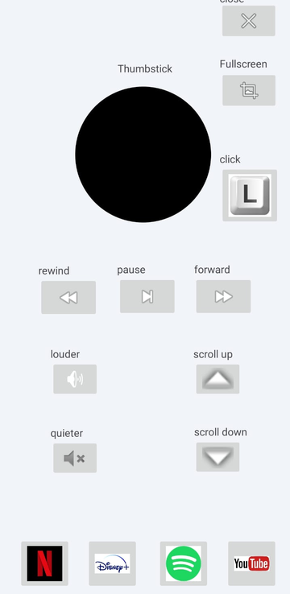
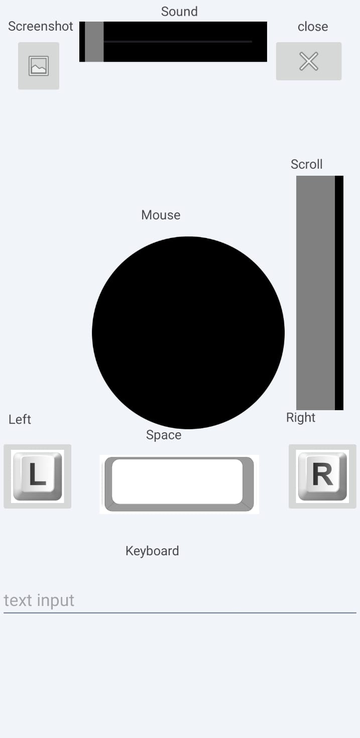
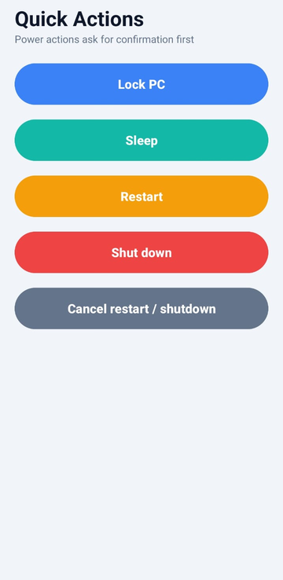

# PC Remote Control

Control your Windows PC from your Android phone over the same Wi-Fi: mouse and touchpad, keyboard, volume and media keys, live screen view, keyboard shortcuts, file transfer, screenshots, PC status and power actions.

| Media | Free-Mode | Quick Actions |
|:---:|:---:|:---:|
|  |  |  |

## Features

- **Media:** mouse stick, play/pause, seek, volume, scroll, fullscreen and Netflix / Disney+ / Spotify / YouTube shortcuts.
- **Free-Mode:** mouse stick, scroll slider, volume slider, left/right click, space bar, screenshot and typing from the phone keyboard.
- **Touchpad:** laptop-style pad. Drag to move, tap to click, two-finger tap to right-click, two fingers up/down to scroll.
- **Screen:** live view of the PC screen. Touch to move the cursor, tap to click, long press to right-click.
- **Shortcuts:** one-tap Copy, Paste, Alt+Tab, Task Manager, media keys and more.
- **Files:** send files to the PC and download files from a folder on the PC.
- **PC Status:** live CPU, RAM, disk and battery.
- **Quick Actions:** lock, sleep, restart, shut down and cancel (power actions ask first).
- **Settings:** dark mode, joystick sensitivity and dead zone, find your PC automatically, scan the QR code or type an IP.

## Install (two downloads, no coding)

Go to the [Releases](../../releases) page and download:

1. **`PC-Remote-Server-Setup-x.y.z.exe`** for your Windows PC. Run it, click Next, and leave "Start PC Remote Server now" ticked. The server window opens, starts by itself and shows your PC's IP address and a QR code. The installer also allows the app through the Windows firewall.
2. **`PC-Remote-*.apk`** for your Android phone. Copy it over, install it (allow "install unknown apps" when asked).

Then put the phone and the PC on the same Wi-Fi, open the app, go to **Settings** and tap your PC under *Found Devices* (or use **manage ip´s** to scan the QR code). That's it.

Windows may show a blue "Windows protected your PC" screen because the installer is not code-signed. Click **More info > Run anyway**. Some antivirus programs also distrust new, unsigned programs.
If your Wi-Fi is set to "Public network" in Windows, change it to "Private", or the phone cannot reach the PC.

Settings, uploads, screenshots and the log are stored in `%LOCALAPPDATA%\PC-Remote-Server`. Use the **Settings** tab in the server window to set a device name and password. Files uploaded from the phone land in `data_folder\for_uploads`, screenshots in `for_screenshots`, and files you put in `for_downloads` can be fetched from the phone (they are saved in `Downloads/PC-Remote` on the phone).

### For developers

- **Run the server from source** (Python 3.9+): double-click `pc-server/run_server.bat`, or `cd pc-server`, create a venv, `pip install -r requirements.txt`, `python main.py`.
- **Build the phone app:** open the **`android-app`** folder in Android Studio, let Gradle sync, then Run.
- **Build the installer yourself:** run `installer/build_exe.bat`, then compile `installer/PC-Remote-Server.iss` with [Inno Setup](https://jrsoftware.org/isinfo.php). GitHub Actions does this automatically, see [docs/RELEASING.md](docs/RELEASING.md).

## Security: please read

- The app and server talk over plain **HTTP** on port `5500`. Nothing is encrypted.
- The password is checked when the phone connects, but the other server routes do **not** require it. Anyone on the same network who can reach port 5500 could control the PC while the server is running.
- Only run the server on networks you trust (your home Wi-Fi), never on public Wi-Fi, and never forward port 5500 to the internet.

## Project layout

```
PC-Remote-Control/
├── pc-server/     Flask server + desktop window (runs on the PC)
├── installer/     Windows installer scripts (PyInstaller + Inno Setup)
├── android-app/   Android Studio project (Java, minSdk 24)
├── docs/          screenshots and release notes
└── .github/       builds the APK automatically
```

## Server API (port 5500)

| Route | Method | Purpose |
|---|---|---|
| `/name`, `/password` | GET, POST | device name, password check |
| `/mouseMove`, `/mouseTo`, `/lc`, `/rc`, `/scroll` | POST / GET | mouse |
| `/sendKeys`, `/backspace`, `/enter`, `/space`, `/left`, `/right`, `/hotkey` | POST / GET | keyboard |
| `/sound`, `/fuScr`, `/clP`, `/net`, `/dis`, `/spo`, `/you` | POST / GET | volume, window and app shortcuts |
| `/screen`, `/screenshot` | GET | live screen JPEG, save a screenshot on the PC |
| `/upload`, `/downloadfolder`, `/download` | POST / GET | file transfer |
| `/status` | GET | CPU, RAM, disk, battery, uptime |
| `/lock`, `/sleep`, `/restart`, `/shutdown`, `/cancel` | POST | power actions |

## Notes

- The server is Windows-only (it uses `os.startfile`, `pycaw` and `pygetwindow`).
- This project builds on the original PC remote by [CopyPasteUser](https://github.com/CopyPasteUser) (MIT license).
- Some ideas (touchpad, live screen, shortcuts, dead zone) were inspired by Monect's PC Remote app. No code was taken from it.
- Release steps are in [docs/RELEASING.md](docs/RELEASING.md), first-time GitHub setup is in [docs/FIRST-PUBLISH.md](docs/FIRST-PUBLISH.md), and changes are listed in [CHANGELOG.md](CHANGELOG.md).

## License

MIT, see [LICENSE](LICENSE).
